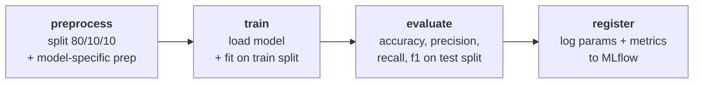

## Pipeline Flow

The `train` flow in `pipeline/flow.py` runs these four tasks in order, after
reading the experiment YAML and building the trainer named in `model.name`.

| Step | Input | Output |
|---|---|---|
| `preprocess` | `data.uri`: a folder with one subfolder per class | a manifest (`path`, `label`, `split`); the trainer holds its prepared data |
| `train` | the trainer | a fitted model inside the trainer |
| `evaluate` | the trainer | a metrics dict |
| `register` | the config and the metrics | one MLflow run |
